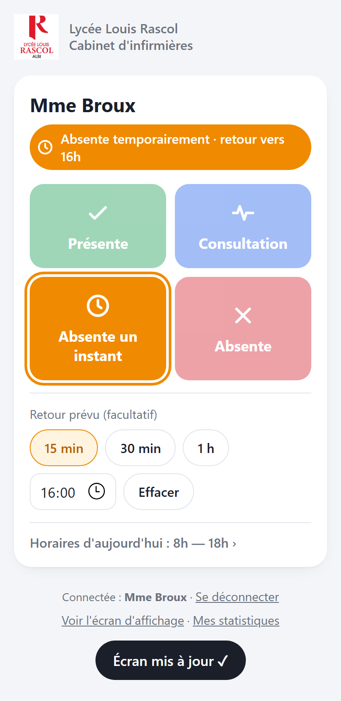

# Affichage de présence des infirmeries

Un grand écran dans le couloir indique en temps réel si chaque infirmière est présente dans son
cabinet, avec ses horaires du jour. Chaque infirmière change son état en deux touches depuis son
téléphone ou son PC. L'administration consulte les statistiques d'activité.

- **Libre et gratuit** (licence MIT), **aucune dépendance** : Python 3 standard uniquement.
- **Se met en place en une trentaine de minutes**, sur le réseau local, **sans Internet, sans nom de domaine, sans certificat**.
- Conçu pour un Raspberry Pi derrière l'écran (HDMI), Chromium en mode kiosque.
- **Statistiques d'activité** : élèves reçus, durée moyenne des consultations, taux d'occupation, graphiques, export CSV et PDF.
- **Réutilisable par n'importe quel établissement** : nom, titre, logo, infirmières et horaires se règlent dans `config.json` (ou avec l'assistant d'installation).
- **Sécurisé par défaut** : un code personnel par compte, droits vérifiés par le serveur ; l'accès depuis Internet est une option, jamais nécessaire.




## Installer en 4 commandes

Sur un Raspberry Pi OS (avec bureau) relié au réseau, en SSH ou au clavier :

```bash
git clone <adresse-du-dépôt> cabinet && cd cabinet
sh deploy/install.sh        # assistant : établissement, infirmières, horaires, codes personnels
sudo reboot                 # l'écran du couloir démarre tout seul
```

L'installation pose quelques questions, génère un **code personnel** pour chaque compte (affiché une
seule fois), installe le serveur et l'écran, puis affiche les adresses à utiliser. **Pas de `sudo`**
(sauf le redémarrage), **pas de configuration réseau particulière**.

Guide complet, avec le matériel et les captures : **[Installation rapide](docs/INSTALLATION-RAPIDE.md)**.

## Où trouver quoi

| Je veux… | Document |
|---|---|
| Installer vite, sur le réseau local | **[docs/INSTALLATION-RAPIDE.md](docs/INSTALLATION-RAPIDE.md)** |
| Tout faire pas à pas (carte SD, SSH, kiosque…), avec captures et dépannage | [docs/GUIDE.md](docs/GUIDE.md) |
| Adapter à mon établissement, déployer dans plusieurs, faire une démonstration | [docs/ADAPTER.md](docs/ADAPTER.md) |
| Comprendre les droits, le HTTPS local, les noms (`.local`), les codes perdus | [docs/SECURITE.md](docs/SECURITE.md) |
| Résoudre un problème (écran, réseau, codes, certificats…) | [docs/DEPANNAGE.md](docs/DEPANNAGE.md) |
| Exploiter au quotidien : sauvegardes, arrivées/départs, mises à jour, arrêt d'urgence | [docs/EXPLOITATION.md](docs/EXPLOITATION.md) |
| *(Option)* Ouvrir l'accès depuis Internet | [docs/INTERNET.md](docs/INTERNET.md) |

## États

| État | Couleur | Affichage |
|---|---|---|
| Présente | vert | PRÉSENTE |
| En consultation | bleu | EN CONSULTATION |
| Absente temporairement | orange | ABSENTE TEMPORAIREMENT, avec « Retour vers 14h30 » (facultatif) |
| Absente (toute la journée) | rouge | ABSENTE |

**À l'heure de fin de ses horaires, l'infirmière repasse automatiquement en « Absente »** (une seule
fois : si elle se remet « Présente » après son heure de fin, son choix est respecté ; si elle allonge
ses horaires, la fermeture est réarmée). Chaque nuit, tout le monde repasse aussi en « Absente » avec
les horaires par défaut, pour éviter un « Présente » oublié. Un **numéro de poste** facultatif peut
s'afficher sous chaque nom.

## Utilisation par les infirmières

Ouvrir `http://<adresse-du-Pi>:8080/admin` sur le téléphone ou le PC (même réseau que le Pi) :

1. Toucher **son nom** puis saisir **son code personnel** : l'infirmière ne voit que **son** panneau.
2. Toucher un des 4 boutons pour changer d'état. L'écran se met à jour en moins d'une seconde.
3. Pour une absence temporaire : choisir facultativement un retour dans 15 min, 30 min, 1 h, ou une heure précise.
4. Pour modifier les horaires du jour : déplier « Horaires d'aujourd'hui », puis *Enregistrer* (« Rétablir les horaires habituels » annule).
5. **Se déconnecter** en bas de page sur un appareil partagé.

Astuce : « Ajouter à l'écran d'accueil » du téléphone. Un lien `…/admin?me=<identifiant>` présélectionne le nom (le code reste obligatoire).

## Sécurité

| Qui | Accès |
|---|---|
| Écran du couloir (réseau interne) | Lecture de la présence, **aucune modification** |
| **Infirmière** | **Son** panneau et **ses** statistiques, avec **son code personnel** |
| **Administration** | Les statistiques de **toutes** les infirmières, en **lecture seule**, avec son code |

Codes **hachés** (scrypt), **blocage** après des essais ratés, sessions limitées, **journal** des
connexions, protection contre les requêtes forgées (CSRF). **Aucun compte sans code ne peut se connecter.**
Facultatif : **HTTPS** local (`sh deploy/setup-https.sh`), noms faciles à retenir, second facteur,
accès depuis Internet : voir [docs/SECURITE.md](docs/SECURITE.md) et [docs/INTERNET.md](docs/INTERNET.md).

## Configuration (`config.json`)

Créé par l'assistant (`deploy/setup.py`) ; exemple dans `config.example.json` :

```json
{
  "school": "Lycée Exemple",
  "title": "Cabinet d'infirmières",
  "logo": "branding/logo.png",
  "port": 8080,
  "minEventSeconds": 10,
  "admins": [ { "id": "administration", "name": "Administration" } ],
  "nurses": [
    { "id": "dupont", "name": "Mme Dupont", "phone": "1001",
      "hours": { "default": ["08:00", "18:00"], "wed": ["08:00", "12:00"] } }
  ]
}
```

- `school` : établissement. `title` : titre au centre de l'écran. `logo` : PNG, JPG ou SVG (sans fichier, un logo par défaut s'affiche).
- `nurses` : une entrée par infirmière, une colonne par entrée sur l'écran (1 à 4 conseillé). `id` : identifiant court **à ne pas changer en cours d'année** (les statistiques y sont rattachées). `phone` : numéro de poste affiché (facultatif).
- `hours.default` : horaires habituels ; une clé `mon`, `tue`, `wed`, `thu`, `fri`, `sat`, `sun` remplace les horaires de ce jour.
- `minEventSeconds` : les changements d'état plus courts (appui par erreur) sont ignorés des statistiques.
- **Les codes ne s'écrivent pas dans ce fichier** : `python3 deploy/pins.py` les stocke hachés.
- Toutes les options (HTTPS, noms, Internet, limites) : [docs/ADAPTER.md](docs/ADAPTER.md) et [docs/INTERNET.md](docs/INTERNET.md).
- `config.json`, `data.db`, `state.json`, `certs/` et `branding/` ne sont **jamais versionnés** (voir `.gitignore`).

Après modification : `systemctl --user restart cabinet.service`.

## Exploitation et dépannage

```bash
systemctl --user status cabinet.service     # état du serveur
journalctl --user -u cabinet.service -f     # journaux
systemctl --user restart cabinet.service    # redémarrer le serveur
curl localhost:8080/api/state               # état courant (JSON)
python3 deploy/pins.py list                 # comptes et état des codes
```

| Problème | Piste |
|---|---|
| Écran noir ou vide au démarrage | Vérifier le service (ci-dessus), puis lancer `~/cabinet/deploy/kiosk.sh` depuis le bureau |
| Pastille orange en bas à droite | Connexion au serveur perdue ; la page se recharge au retour |
| `/admin` injoignable depuis le téléphone | Pas sur le même réseau que le Pi (pas en 4G, pas Wi-Fi invité) |
| « Code incorrect » | `python3 deploy/pins.py set nurse:<identifiant>` |

Pour tout remettre à zéro : supprimer `state.json` puis redémarrer le service.

## Organisation du dépôt

| Chemin | Rôle |
|---|---|
| `server.py`, `auth.py`, `mdns.py` | Serveur HTTP/HTTPS + temps réel (SSE), comptes et sessions, noms `.local` |
| `static/` | Pages : écran (`index.html`), panneau (`admin.html`), statistiques (`stats.html`) |
| `deploy/` | `install.sh`, `setup.py` (assistant), `pins.py` (codes), `setup-https.sh`, `install-cert.sh`, `set-static-ip.sh`, `setup-vnc.sh`, `use-standard-ports.sh` |
| `tools/` | `check-exposure.py` (contrôle externe), `demo-data.py` (fausses statistiques de démonstration) |
| `tests/` | Suites de tests (sécurité, Internet, changement d'IP) : `python3 tests/test_security.py` |
| `docs/` | Documentation |

## API

| Route | Description |
|---|---|
| `GET /` | Page d'affichage (réseau interne) |
| `GET /admin`, `GET /stats` | Panneau et statistiques (écran de connexion si pas de session) |
| `GET /api/state`, `GET /api/events` | État courant et flux temps réel (SSE) : réseau interne, ou session |
| `GET /api/accounts` | Noms des comptes pour l'écran de connexion (jamais de code) |
| `POST /api/login` | `{"role":"nurse"\|"admin","id":"…","pin":"…"}` → cookie de session |
| `POST /api/logout`, `GET /api/me` | Fermer la session ; compte connecté |
| `POST /api/set` | Infirmière connectée, pour son panneau : `{"status":"pause","back":"14:30"}`, `{"start","end"}` ou `{"resetHours":true}` |
| `GET /api/stats?from=…&to=…[&nurse=<id>]`, `/api/stats.csv`, `/api/events.csv` | Statistiques : administration = toutes, infirmière = les siennes |

`status` : `present`, `consult`, `pause`, `absent` ; `back` seulement pour `pause` ; heures au format `HH:MM` ; `"next": true` avec `"status":"consult"` ouvre une nouvelle consultation. Routes protégées : **401** sans session, **403** sans droit, **429** pendant un blocage.

## Limites connues

- Les statistiques mesurent ce que les infirmières déclarent avec les boutons : une consultation oubliée ouverte fausse les chiffres. Elles ne remplacent pas un registre officiel.
- Au-delà de 4 infirmières sur un même écran, les textes deviennent petits.
- Les horaires sont par jour de la semaine ; pas de calendrier (vacances, jours fériés).
- Sur un réseau local en HTTP, les codes circulent en clair : activer le HTTPS local si le réseau n'est pas maîtrisé. Exposer l'application sur Internet reste une **option avancée** à décider avec le service informatique.

## Licence

MIT, voir [LICENSE](LICENSE).
