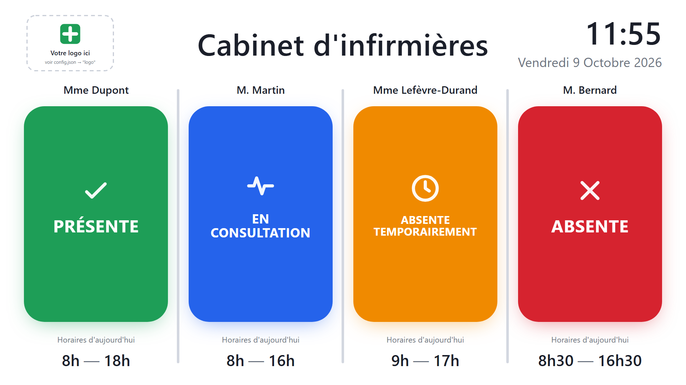

# Adapter la solution à un autre établissement

Le même code sert à tous les lycées : **seuls trois éléments sont propres à un
établissement** et ne sont jamais partagés par le dépôt.

| Élément | Où | Contenu |
|---|---|---|
| `config.json` | dossier de l'application | Nom de l'établissement, titre, infirmières, horaires, code d'accès |
| `branding/logo.*` | dossier `branding/` | Le logo de l'établissement |
| `data.db`, `state.json` | dossier de l'application | Données d'activité (créées automatiquement) |

Ces fichiers sont exclus par le `.gitignore` : on peut donc mettre à jour le code
sans écraser l'identité d'un établissement, et publier le dépôt sans y exposer de
noms ni de statistiques.

Un Raspberry Pi = un établissement (ou un groupe de cabinets qui partagent le même écran).

## Checklist de déploiement

1. **Préparer le Pi** : suivre les étapes 1 à 5 du [guide pas à pas](GUIDE.md) (carte SD, réseau, SSH).
2. **Récupérer le code** sur le PC puis le copier sur le Pi :
   ```powershell
   git clone <URL_DU_DEPOT> cabinet
   scp -r cabinet <utilisateur>@<IP>:/home/<utilisateur>/
   ```
3. **Créer la configuration** de l'établissement (sur le Pi) :
   ```bash
   cd ~/cabinet
   cp config.example.json config.json
   nano config.json
   ```
4. **Déposer le logo** (depuis le PC) :
   ```powershell
   scp mon-logo.png <utilisateur>@<IP>:/home/<utilisateur>/cabinet/branding/logo.png
   ```
5. **Installer** (sur le Pi) puis redémarrer :
   ```bash
   sh deploy/install.sh
   sudo reboot
   ```
6. **Vérifier** : l'écran affiche le logo, le titre et une carte par infirmière (étape 7 du guide).
7. **Former les infirmières** : leur donner leur lien personnel `http://<IP>:8080/admin?me=<id>` (étape 9).

## Ce qui se règle dans `config.json`

```json
{
  "school": "Lycée Jean Moulin",
  "title": "Cabinet d'infirmières",
  "logo": "branding/logo.png",
  "port": 8080,
  "pin": "4821",
  "minEventSeconds": 10,
  "nurses": [
    { "id": "dupont", "name": "Mme Dupont",
      "hours": { "default": ["08:00", "18:00"], "wed": ["08:00", "12:00"] } },
    { "id": "martin", "name": "M. Martin",
      "hours": { "default": ["08:00", "16:00"] } }
  ]
}
```

| Champ | À adapter | Effet |
|---|---|---|
| `school` | Nom de votre établissement | En-têtes des pages infirmières et statistiques |
| `title` | Par exemple « Infirmerie », « Cabinet médical » | Titre au centre de l'écran |
| `logo` | Chemin du fichier logo (PNG, JPG ou SVG) | Affiché en haut à gauche de l'écran et des pages |
| `pin` | Un code de votre choix | Protège les changements d'état et les statistiques |
| `nurses` | Une entrée par personne | Une colonne par entrée sur l'écran |
| `nurses[].id` | Court, sans espace ni accent, **unique** | Identifie la personne (liens `?me=`, statistiques) |
| `nurses[].name` | Le nom affiché (« Mme Dupont », « M. Martin »…) | Titre de la carte |
| `nurses[].hours` | Horaires habituels, par jour si besoin | Affichage, et heure du passage automatique en « Absente » |

Après toute modification : `systemctl --user restart cabinet.service`.

> **Important** : ne changez pas l'`id` d'une infirmière en cours d'année. Ses
> statistiques sont rattachées à cet identifiant.

### Le logo

- Formats acceptés : PNG, JPG, SVG. Un fond transparent ou blanc rend le mieux : l'écran a un fond blanc.
- Format idéal : plutôt **large que haut**, par exemple 600 × 300 px (il est affiché à une hauteur fixe, d'environ 9 % de la largeur de l'écran).
- Un logo trop grand en poids est sans effet sur l'affichage mais ralentit le chargement : visez moins de 500 Ko.
- Sans fichier, un logo par défaut « Votre logo ici » s'affiche : c'est le signe que le chemin `logo` est faux ou le fichier absent.
- Respectez les droits d'usage du logo : si vous publiez le dépôt, ne versionnez pas le logo (c'est le cas par défaut, le dossier `branding/` est ignoré).

### Le nombre d'infirmières

L'écran affiche **une colonne par infirmière** et adapte la taille des textes à la
largeur disponible. Testé avec 2 et 4 personnes :



Au-delà de 4 colonnes, les textes deviennent petits pour un écran vu de loin :
dans ce cas, préférez un second écran avec son propre Pi.

## Ce qui ne change pas d'un établissement à l'autre

- Les **quatre états** et leurs couleurs (vert, bleu, orange, rouge) : elles sont volontairement identiques partout pour être reconnues d'un coup d'œil.
- La **langue** : les textes de l'interface sont en français (ils sont dans `static/common.js` pour les états, et dans les pages `static/*.html`).
- Le **fonctionnement** : passage automatique en « Absente » à l'heure de fin, remise à zéro chaque nuit, statistiques.

## Mettre à jour plusieurs établissements

La mise à jour du code ne touche pas à `config.json`, à `branding/` ni aux données :
```powershell
scp -r cabinet\server.py cabinet\static <utilisateur>@<IP>:/home/<utilisateur>/cabinet/
ssh <utilisateur>@<IP> "systemctl --user restart cabinet.service"
```
Si une mise à jour ajoute un champ de configuration, il est décrit ici et dans le [guide](GUIDE.md) ; les champs absents prennent une valeur par défaut.

## Aide-mémoire pour un nouvel établissement

- [ ] Carte SD préparée, Pi sur le réseau, SSH fonctionnel
- [ ] `config.json` : `school`, `title`, `nurses`, `hours`
- [ ] Logo dans `branding/` et chemin `logo` correct
- [ ] `pin` défini
- [ ] `sh deploy/install.sh` puis redémarrage
- [ ] Écran vérifié, un changement d'état testé depuis un téléphone
- [ ] Veille de l'écran désactivée, IP réservée (DHCP)
- [ ] Liens personnels (`?me=`) transmis aux infirmières
