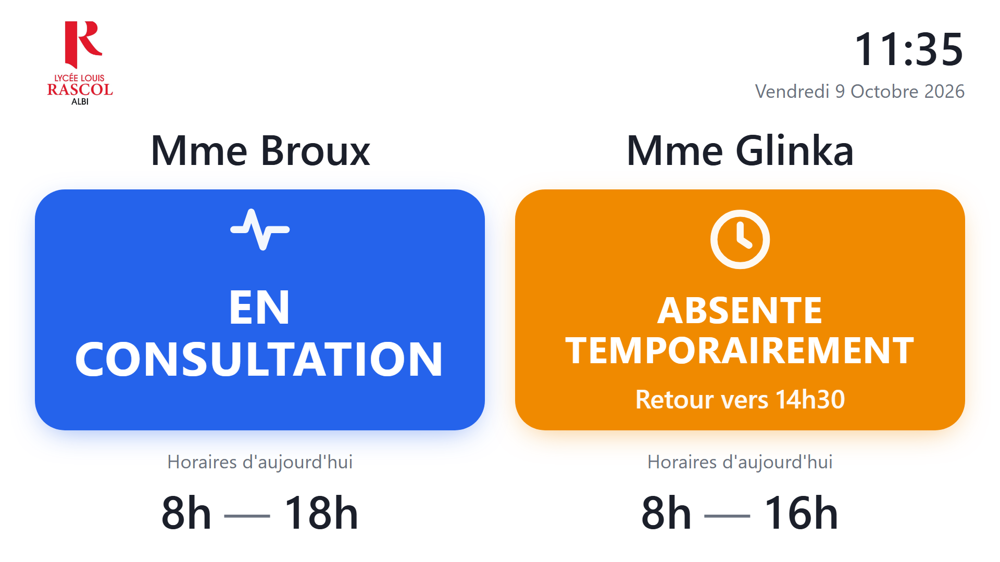
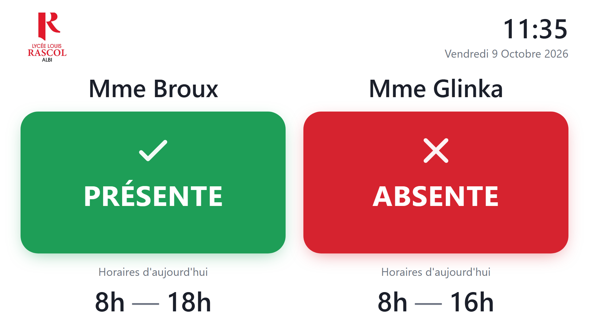
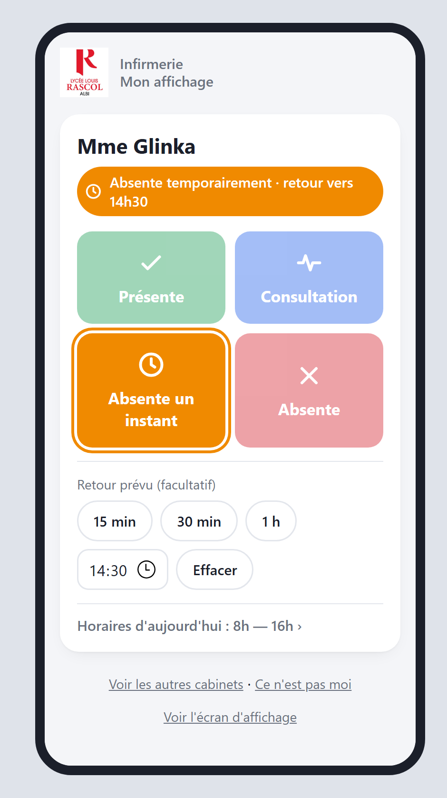

# Guide pas à pas : de la carte SD à l'écran en service

Ce guide refait toute la mise en place, dans l'ordre, avec le détail de chaque
geste. Chaque étape se termine par une **✅ Vérification** : ne passez à la
suivante que si elle est bonne.

**Convention** : les blocs `powershell` se tapent sur le **PC Windows** ; les blocs
`bash` se tapent sur le **Raspberry Pi**, une fois connecté en SSH (étape 5).
Les valeurs entre chevrons (`<IP>`, `<utilisateur>`) sont à remplacer par les vôtres.
Dans notre installation : IP `10.5.35.101`, nom d'hôte `pi-infirmerie`.

## Sommaire

0. [Le résultat visé](#0-le-résultat-visé)
1. [Matériel](#1-matériel)
2. [Préparer la carte SD](#2-préparer-la-carte-sd)
3. [Brancher et démarrer](#3-brancher-et-démarrer)
4. [Trouver l'adresse IP du Pi](#4-trouver-ladresse-ip-du-pi)
5. [Se connecter en SSH](#5-se-connecter-en-ssh)
6. [Installer l'application](#6-installer-lapplication)
7. [Vérifier le kiosque et redémarrer](#7-vérifier-le-kiosque-et-redémarrer)
8. [Réglages de l'écran et du réseau](#8-réglages-de-lécran-et-du-réseau)
9. [Utilisation par les infirmières](#9-utilisation-par-les-infirmières)
10. [Mettre à jour l'application](#10-mettre-à-jour-lapplication)
11. [Dépannage](#11-dépannage)
12. [Annexes](#12-annexes)

---

## 0. Le résultat visé

Le besoin de départ était ce schéma : une colonne par infirmière, un grand bloc
de couleur pour l'état, et les horaires du jour.


Le résultat obtenu, sur l'écran du couloir (ici, Mme Broux en consultation et
Mme Glinka absente temporairement, avec son retour prévu) :



Et avec une infirmière présente et l'autre absente :



| État | Couleur | Texte affiché |
|---|---|---|
| Présente | vert | PRÉSENTE |
| En consultation | bleu | EN CONSULTATION |
| Absente temporairement | orange | ABSENTE TEMPORAIREMENT, avec « Retour vers 14h30 » si renseigné |
| Absente (toute la journée) | rouge | ABSENTE |

Chaque infirmière change son état depuis son téléphone (voir [l'étape 9](#9-utilisation-par-les-infirmières)).

## 1. Matériel

| Élément | Remarque |
|---|---|
| Raspberry Pi | Testé sur un modèle 64 bits, 2 Go de RAM |
| Alimentation officielle | Une alimentation faible provoque des plantages |
| Carte microSD, 16 Go ou plus | De marque connue (SanDisk, Samsung…) |
| Lecteur de cartes SD pour le PC | Un lecteur USB externe est souvent plus fiable que celui d'un portable |
| Câble HDMI | Selon le modèle de Pi : HDMI ou micro-HDMI, vers l'écran |
| Câble réseau RJ-45 | Vers un port du switch ; le Wi-Fi n'est pas nécessaire |
| PC Windows | Avec [Raspberry Pi Imager](https://www.raspberrypi.com/software/) installé |

## 2. Préparer la carte SD

> ⚠️ La carte sera **entièrement effacée**. Sauvegardez ce qu'elle contient.

### 2.1 Lancer Pi Imager

1. Insérer la carte SD dans le lecteur du PC.
2. Ouvrir **Raspberry Pi Imager** (version 2.x dans notre cas). Les écrans se suivent dans le menu de gauche : *Appareil*, *Système*, *Stockage*, *Personnalisation*, *Écriture*, *Terminé*.

### 2.2 Choisir l'appareil, le système et le stockage

| Écran | Choix |
|---|---|
| **Appareil** | Votre modèle de Raspberry Pi |
| **Système** | **Raspberry Pi OS (64-bit)**, version **avec bureau** (la version « Lite » ne convient pas : il faut Chromium) |
| **Stockage** | La carte SD. **Vérifiez la taille** pour ne pas choisir un autre disque |

### 2.3 Personnalisation

Dans l'écran *Personnalisation*, renseigner :

| Réglage | Valeur |
|---|---|
| **Nom d'hôte** | `pi-infirmerie` (ou un autre nom sans espace) |
| **Localisation** | Fuseau horaire `Europe/Paris`, disposition du clavier `fr` |
| **Compte utilisateur** | Un identifiant (par exemple `infirmerie`) et un mot de passe solide. **Notez-les dans un gestionnaire de mots de passe.** Ne les écrivez jamais dans ce dépôt |
| **SSH** | **Activé**, authentification par mot de passe (ou par clé publique si vous en avez une) |
| Wi-Fi | Inutile : le Pi est branché en câble |

L'écran *Écriture* affiche ensuite un résumé : nom d'hôte, localisation et compte configurés, SSH activé. Vérifiez-le.

### 2.4 Écrire la carte

1. Cliquer sur **Écrire** et confirmer l'effacement.
2. Attendre la fin de l'écriture **et** de la vérification (quelques minutes).
3. Quand *Terminé* s'affiche, retirer la carte proprement.

✅ **Vérification** : Pi Imager indique que l'écriture et la vérification ont réussi.

### 2.5 Si l'écriture échoue

Message rencontré :


> *Error writing to storage device… Device disconnected or became unresponsive • Device is full or write-protected • Hardware failure or bad sectors*

La cause est presque toujours la carte, le lecteur ou l'état du disque, pas Pi Imager. Essayez **dans cet ordre** :

1. **Autre port USB** (en direct sur le PC, pas sur un hub) ou **autre lecteur** de cartes.
2. **Verrou physique** : sur l'adaptateur SD, le petit curseur doit être en position déverrouillée.
3. **Droits et antivirus** : lancer Pi Imager en administrateur (clic droit → *Exécuter en tant qu'administrateur*), et désactiver temporairement l'antivirus ou l'« Accès contrôlé aux dossiers » de Windows Defender.
4. **Nettoyer la carte avec `diskpart`** (invite de commandes **en administrateur**).
   > ⚠️ Vérifiez le numéro de disque **par sa taille**. Cette commande efface le disque choisi.
   ```
   diskpart
   list disk
   select disk X
   attributes disk clear readonly
   clean
   create partition primary
   format fs=fat32 quick
   exit
   ```
   Remplacer `X` par le numéro de la carte SD dans `list disk`.
5. **Reformater avec l'outil officiel** *SD Memory Card Formatter* (SD Association), option « Overwrite format ».
6. **Tester la carte** avec *H2testw* ou *F3* (fausse capacité ou carte défectueuse). Si possible, essayer **une autre carte** : si ça marche, la première est en fin de vie.
7. En dernier recours : une version précédente de Pi Imager (1.9.x) ou *balenaEtcher*.

## 3. Brancher et démarrer

1. Insérer la carte SD dans le Pi (fente sous la carte, contacts vers la carte).
2. Brancher **dans cet ordre** : le câble **HDMI** vers l'écran (écran allumé), le câble **réseau** vers le switch, puis l'**alimentation** en dernier.
3. Attendre **1 à 2 minutes**. Au premier démarrage, le Pi applique la personnalisation et peut redémarrer seul une fois.

✅ **Vérification** : le bureau de Raspberry Pi OS apparaît sur l'écran.

Si l'écran reste noir : vérifier que l'écran est sur la bonne entrée HDMI, que la LED verte du Pi clignote (accès à la carte), et que l'alimentation est suffisante.

## 4. Trouver l'adresse IP du Pi

Le PC doit être sur le même réseau que le Pi. Trois méthodes, de la plus simple à la plus technique.

### Méthode A : depuis le Pi

Sur le bureau du Pi, ouvrir un terminal (icône ▮ dans la barre du haut) et taper :
```bash
hostname -I
```
La première adresse affichée est l'IP (par exemple `10.5.35.101`).

### Méthode B : depuis le PC, avec le nom d'hôte

```powershell
ping pi-infirmerie.local
```
Si une réponse arrive, l'adresse IP est indiquée entre crochets. Si le nom n'est pas trouvé, passer à la méthode C.

### Méthode C : depuis le switch Aruba 2530

Se connecter à la console du switch (voir l'[annexe A](#a-console-du-switch-aruba-2530)), puis :
```
enable
show arp
show mac-address
```
`show arp` liste les adresses IP vues par le switch ; `show mac-address` indique **sur quel port** chaque machine est branchée. Repérer le port où le Pi est branché.

### Contrôle

```powershell
ping <IP>
```
Réponse attendue :
```
Réponse de 10.5.35.101 : octets=32 temps<1ms TTL=64
```
(`TTL=64` est typique d'un système Linux.)

✅ **Vérification** : le ping répond, sans perte de paquets.

## 5. Se connecter en SSH

### 5.1 Tester que SSH répond

```powershell
Test-NetConnection <IP> -Port 22
```
`TcpTestSucceeded : True` signifie que le service SSH écoute. Si c'est `False`, voir le [dépannage](#11-dépannage).

### 5.2 Se connecter

```powershell
ssh <utilisateur>@<IP>
```
- Au **premier** accès, une question sur l'empreinte du serveur apparaît : répondre `yes`.
- Saisir le mot de passe. **Rien ne s'affiche pendant la frappe** : c'est normal.

✅ **Vérification** : l'invite du Pi apparaît, du type `infirmerie@pi-infirmerie:~ $`.

### 5.3 Confort : connexion par clé (facultatif)

Évite de retaper le mot de passe. Sur le PC :

1. Créer une clé dédiée à ce Pi :
   ```powershell
   ssh-keygen -t ed25519 -f $env:USERPROFILE\.ssh\id_ed25519_pi -N '""'
   ```
2. Installer la clé publique sur le Pi (le mot de passe est demandé cette seule fois) :
   ```powershell
   type $env:USERPROFILE\.ssh\id_ed25519_pi.pub | ssh <utilisateur>@<IP> "mkdir -p ~/.ssh && chmod 700 ~/.ssh && cat >> ~/.ssh/authorized_keys && chmod 600 ~/.ssh/authorized_keys"
   ```
3. Tester :
   ```powershell
   ssh -i $env:USERPROFILE\.ssh\id_ed25519_pi <utilisateur>@<IP> hostname
   ```
   Le nom d'hôte du Pi doit s'afficher sans mot de passe.

Pour retirer un accès, supprimer la ligne correspondante dans `~/.ssh/authorized_keys` sur le Pi.

## 6. Installer l'application

### 6.1 Copier les fichiers sur le Pi

Sur le PC, depuis le dossier qui contient `cabinet` (récupéré avec `git clone <URL_DU_DEPOT>`) :
```powershell
scp -r cabinet <utilisateur>@<IP>:/home/<utilisateur>/
```

### 6.2 Créer la configuration

Sur le Pi (en SSH) :
```bash
cd ~/cabinet
cp config.example.json config.json
nano config.json
```
Contenu type, à adapter :
```json
{
  "title": "Infirmerie",
  "port": 8080,
  "pin": "",
  "nurses": [
    { "id": "broux",  "name": "Mme Broux",  "hours": { "default": ["08:00", "18:00"] } },
    { "id": "glinka", "name": "Mme Glinka", "hours": { "default": ["08:00", "16:00"] } }
  ]
}
```

| Champ | Rôle |
|---|---|
| `title` | Nom affiché dans les interfaces |
| `port` | Port HTTP du serveur (8080 par défaut) |
| `pin` | Code d'accès facultatif pour modifier un état. Vide = pas de code |
| `nurses[].id` | Identifiant court, sans espace ni accent |
| `nurses[].name` | Nom affiché sur l'écran |
| `hours.default` | Horaires habituels `["début", "fin"]` |
| `hours.mon` … `hours.sun` | Horaires propres à un jour (`mon`, `tue`, `wed`, `thu`, `fri`, `sat`, `sun`) |

Pour enregistrer dans `nano` : `Ctrl+O` puis `Entrée` ; pour quitter : `Ctrl+X`.

Exemple : horaires réduits le mercredi → `"hours": { "default": ["08:00","18:00"], "wed": ["08:00","12:00"] }`.

### 6.3 Vérifier Python

```bash
python3 --version
```
Une version 3.x s'affiche (Python 3.13 sur Raspberry Pi OS « trixie »). Aucune bibliothèque n'est à installer.

### 6.4 Lancer l'installation

```bash
sh deploy/install.sh
```
Sortie attendue :
```
Created symlink '.../default.target.wants/cabinet.service' → '.../cabinet.service'.
Installation terminée. Redémarrez le Pi : sudo reboot
```
Le script crée, **sans `sudo`** :
- `~/.config/systemd/user/cabinet.service` : le serveur, démarré automatiquement et relancé s'il plante ;
- `~/.config/labwc/autostart` : lance `deploy/kiosk.sh`, c'est-à-dire Chromium en plein écran sur `http://localhost:8080/` (relancé s'il se ferme).

> `autostart` remplace celui du système : plus de barre des tâches ni de bureau à l'écran. C'est voulu pour un kiosque. Pour revenir au bureau : supprimer `~/.config/labwc/autostart`.

### 6.5 Contrôler le serveur

```bash
systemctl --user status cabinet.service
curl localhost:8080/api/state
```
La première commande doit afficher `active (running)`. La seconde renvoie du JSON où figurent vos infirmières, toutes en `"status": "absent"` au départ.

✅ **Vérification** : service actif et JSON reçu.

## 7. Vérifier le kiosque et redémarrer

1. Redémarrer :
   ```bash
   sudo reboot
   ```
2. Attendre environ une minute. Sans toucher à rien, l'écran doit afficher le logo, l'heure et une carte rouge « ABSENTE » par infirmière :

   
   *(Capture avec une infirmière présente ; au tout premier démarrage, les deux cartes sont rouges.)*

✅ **Vérification** : l'affichage apparaît tout seul, en plein écran, sans curseur ni barre.

Si ce n'est pas le cas :
```bash
systemctl --user status cabinet.service     # le serveur tourne-t-il ?
cat ~/.config/labwc/autostart               # le kiosque est-il déclaré ?
~/cabinet/deploy/kiosk.sh                   # le lancer à la main depuis le bureau
```

## 8. Réglages de l'écran et du réseau

### 8.1 Empêcher l'extinction de l'écran

```bash
sudo raspi-config
```
Menu *Display Options* → *Screen Blanking* → **désactiver**. Valider puis quitter.

### 8.2 Fixer l'adresse IP

Si l'IP change, les téléphones ne retrouvent plus la page. Demander au service informatique une **réservation DHCP** liée à l'adresse MAC du Pi :
```bash
ip link show eth0
```
La ligne `link/ether xx:xx:xx:xx:xx:xx` donne l'adresse MAC.

### 8.3 Protéger la modification par un code (recommandé)

Sans code, toute personne du réseau du lycée qui connaît l'adresse `/admin` peut changer l'affichage.

1. Éditer la configuration :
   ```bash
   nano ~/cabinet/config.json
   ```
   et renseigner par exemple `"pin": "4821"` (choisissez le vôtre).
2. Redémarrer le serveur :
   ```bash
   systemctl --user restart cabinet.service
   ```
3. Au premier changement d'état sur chaque téléphone, le code est demandé, puis retenu sur l'appareil.

## 9. Utilisation par les infirmières

### 9.1 Ouvrir la page

Sur le téléphone (connecté au réseau du lycée) :

```
http://<IP>:8080/admin
```
Il est pratique de donner à chaque infirmière **son lien personnel**, qui sélectionne son nom d'office :
```
http://<IP>:8080/admin?me=broux
http://<IP>:8080/admin?me=glinka
```
(`me=` reprend l'`id` du fichier de configuration.) On peut en faire un QR code à coller près de l'écran.

### 9.2 Premier accès : choisir son nom

À la première visite sans lien personnel, toucher son nom. L'appareil s'en souvient.


### 9.3 Changer d'état

La page montre l'état actuel (bandeau en haut) et quatre gros boutons. Le bouton actif est entouré, les autres sont atténués.


| Bouton | Quand l'utiliser |
|---|---|
| **Présente** (vert) | Je suis au cabinet |
| **Consultation** (bleu) | Je reçois un élève |
| **Absente un instant** (orange) | Je m'absente un moment |
| **Absente** (rouge) | Je ne suis pas là |

Un message « Écran mis à jour ✓ » confirme le changement, et l'écran du couloir change en moins d'une seconde.

### 9.4 Indiquer un retour (absence temporaire)

Après avoir touché **Absente un instant**, une zone « Retour prévu (facultatif) » apparaît :



- **15 min**, **30 min**, **1 h** : propose une heure de retour arrondie aux 5 minutes ;
- le champ d'heure permet de saisir une heure précise ;
- **Effacer** retire l'heure de retour.

L'écran affiche alors « Retour vers 14h30 ». Si l'heure est dépassée sans changement d'état, il affiche « Retour imminent ».

### 9.5 Modifier les horaires du jour

Toucher « Horaires d'aujourd'hui », régler l'heure de début et de fin, puis **Enregistrer**. La mention « (modifiés) » apparaît, et **Rétablir les horaires habituels** annule la modification.


Ces horaires ne valent que pour la journée en cours.

### 9.6 Comportements automatiques

- **À l'heure de fin** des horaires du jour, l'infirmière repasse toute seule en **Absente**. Cela ne se produit qu'une fois : si elle se remet « Présente » après son heure de fin (elle reste plus tard), son choix est respecté. Si elle allonge ses horaires, la fermeture est réarmée pour la nouvelle heure de fin.
- **Chaque nuit** (changement de date), tout le monde repasse en **Absente** avec les horaires habituels. Il n'y a donc pas de « Présente » oublié le lendemain.
- **Avant l'heure de début**, rien n'est forcé : une infirmière arrivée plus tôt peut se mettre « Présente » dès son arrivée.

### 9.7 Autres cabinets

Le lien « Voir les autres cabinets » affiche aussi les autres infirmières (par exemple pour remplacer une collègue). « Ce n'est pas moi » oublie le nom retenu sur l'appareil.

Astuce : sur le téléphone, *Ajouter à l'écran d'accueil* depuis le navigateur crée une icône qui ouvre directement la page.

✅ **Vérification** : changer un état depuis un téléphone ; l'écran change en moins d'une seconde.

## 10. Mettre à jour l'application

Depuis le PC, après modification du code :
```powershell
scp -r cabinet\server.py cabinet\static <utilisateur>@<IP>:/home/<utilisateur>/cabinet/
ssh <utilisateur>@<IP> "systemctl --user restart cabinet.service"
```
Pour une modification de la page d'affichage seulement, copier le fichier puis recharger l'écran (redémarrer le Pi, ou fermer Chromium : `kiosk.sh` le relance).

Modifier la configuration (noms, horaires) : éditer `~/cabinet/config.json` sur le Pi, puis `systemctl --user restart cabinet.service`.

Les fichiers `config.json` et `state.json` ne sont jamais écrasés par une mise à jour si vous ne copiez que `server.py` et `static`.

## 11. Dépannage

### Réseau et connexion

| Symptôme | Cause probable | Solution |
|---|---|---|
| `ping` ne répond pas | Mauvaise IP, Pi éteint, PC sur un autre réseau | Revoir l'étape 4 ; vérifier le câble réseau et le VLAN du port du switch |
| SSH : `Connection timed out` | Pi non démarré ou injoignable | Vérifier l'alimentation, le câble, l'IP |
| SSH : `Connection refused` | SSH non activé | Refaire la personnalisation de la carte (étape 2.3) |
| SSH : `Permission denied` | Mauvais identifiant ou mot de passe | Vérifier la casse et le clavier (AZERTY/QWERTY) |
| `/admin` injoignable depuis le téléphone | Téléphone en 4G ou sur un autre réseau | Se connecter au réseau du lycée ; vérifier qu'il peut joindre l'IP du Pi |

### Application

| Symptôme | Cause probable | Solution |
|---|---|---|
| Écran noir au démarrage | Serveur ou kiosque non lancé | Voir l'étape 7 |
| Écran qui s'éteint | Veille activée | Étape 8.1 |
| Petite pastille orange en bas à droite de l'écran | Connexion au serveur perdue | Elle disparaît toute seule et la page se recharge au retour du serveur ; sinon, redémarrer le service |
| Les changements n'apparaissent pas | Page ancienne ou serveur bloqué | Recharger la page ; `curl localhost:8080/api/state` sur le Pi |
| Le code est redemandé en boucle | Code erroné | Recharger la page et ressaisir le bon code |
| Message « Serveur injoignable » sur le téléphone | Réseau coupé | Vérifier la connexion du téléphone |

### Commandes utiles sur le Pi

```bash
systemctl --user status cabinet.service     # état du serveur
journalctl --user -u cabinet.service -f     # journaux en direct (Ctrl+C pour quitter)
systemctl --user restart cabinet.service    # redémarrer le serveur
curl localhost:8080/api/state               # état courant (JSON)
```
Remettre l'état à zéro :
```bash
systemctl --user stop cabinet.service
rm ~/cabinet/state.json
systemctl --user start cabinet.service
```

## 12. Annexes

### A. Console du switch Aruba 2530

Utile pour trouver l'IP du Pi ou régler le réseau.

1. Brancher un câble micro-USB **de données** (pas un simple câble de charge) sur le port console à l'avant du switch.
2. Dans le Gestionnaire de périphériques, repérer le port `COMx` sous *Ports (COM et LPT)*. S'il manque, installer le pilote **Silicon Labs CP210x** puis rebrancher.
3. Ouvrir **PuTTY** ou **Tera Term** avec : connexion *Serial*, port `COMx`, **9600** bauds, 8 bits de données, aucune parité, 1 bit d'arrêt, **aucun** contrôle de flux. Appuyer plusieurs fois sur `Entrée`.
4. Commandes utiles :
   ```
   enable
   show ip                   # adresses IP du switch et des VLAN
   show arp                  # machines vues sur le réseau
   show mac-address          # port auquel chaque machine est branchée
   configure
   vlan 1
   ip address 192.168.1.10 255.255.255.0
   exit
   telnet-server             # activer Telnet (préférer SSH si possible)
   password manager          # définir un mot de passe
   write memory              # enregistrer la configuration
   ```
5. Se connecter ensuite au switch en Telnet depuis le PC (fonction à activer dans Windows) :
   ```powershell
   dism /online /Enable-Feature /FeatureName:TelnetClient
   telnet 192.168.1.10
   ```
6. Mot de passe perdu : le bouton **Clear** en façade l'efface. Le bouton **Reset** redémarre le switch ; une réinitialisation d'usine efface toute la configuration.

> Telnet transmet les mots de passe en clair. Préférer SSH quand c'est possible.

### B. Architecture

```
Téléphone / PC infirmière ──► /admin ──POST /api/set──┐
                                                       ▼
                                     server.py (Python, état dans state.json)
                                                       │ Server-Sent Events (/api/events)
                                                       ▼
        Chromium kiosque sur le Pi (HDMI) ◄── /  (page d'affichage)
```

| Fichier | Rôle |
|---|---|
| `server.py` | Serveur HTTP, temps réel (SSE), validation, sauvegarde de l'état, fermeture automatique |
| `config.json` | Infirmières, horaires, code d'accès (non versionné) |
| `static/index.html` | Page d'affichage de l'écran |
| `static/admin.html` | Page de commande des infirmières |
| `static/common.js` | Statuts, couleurs et fonctions partagées |
| `deploy/install.sh` | Installation du service et du kiosque |

Pour les captures d'écran de cette documentation, l'option `?nosse` (par exemple `/?nosse`) désactive le flux temps réel.

### C. Publier le dépôt sur GitHub

```bash
gh auth login
cd cabinet
gh repo create affichage-infirmerie --private --source=. --push
```
`config.json` (noms du personnel) et `state.json` sont exclus par `.gitignore` et ne sont jamais publiés. **Ne jamais commiter** de mot de passe, de code d'accès ni de clé privée.

### D. Sécurité en bref

- L'application est prévue pour le **réseau interne** du lycée, en HTTP : ne pas l'exposer sur Internet.
- Utiliser le `pin` pour limiter les modifications (étape 8.3).
- Garder les identifiants du Pi hors du dépôt et hors des messages partagés.
- Utiliser une clé SSH dédiée, révocable, plutôt que de partager le mot de passe du Pi.
