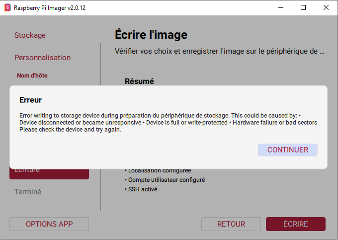
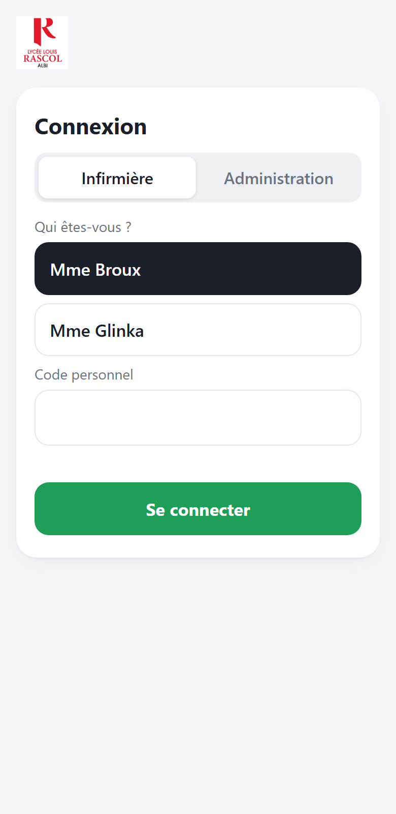
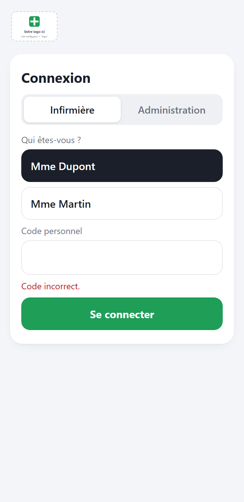
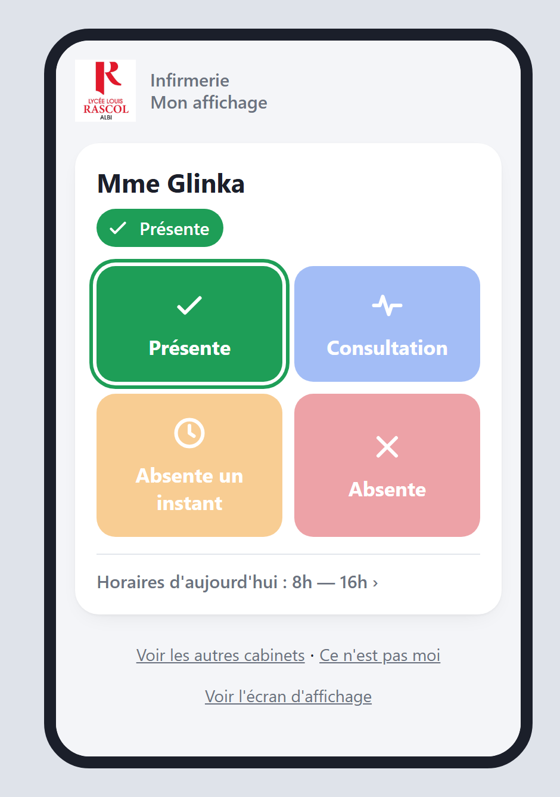
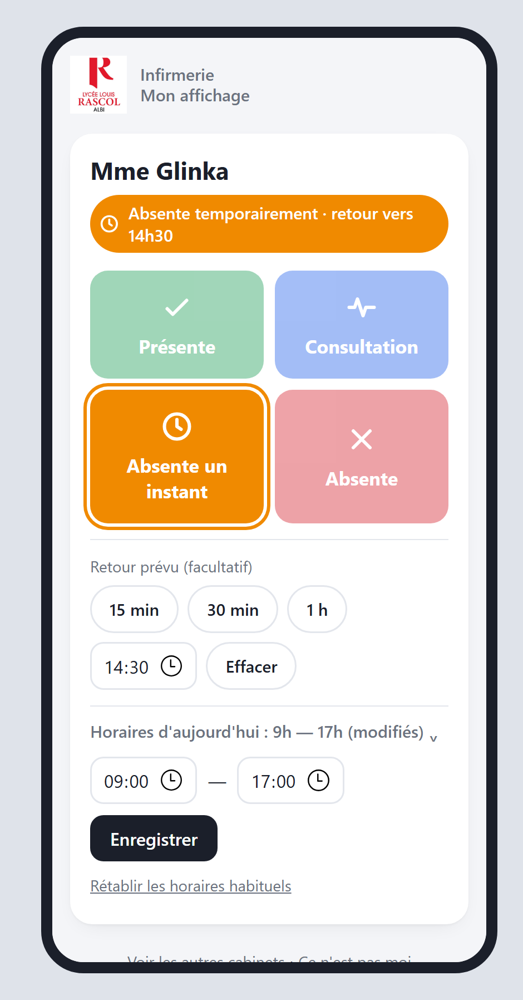
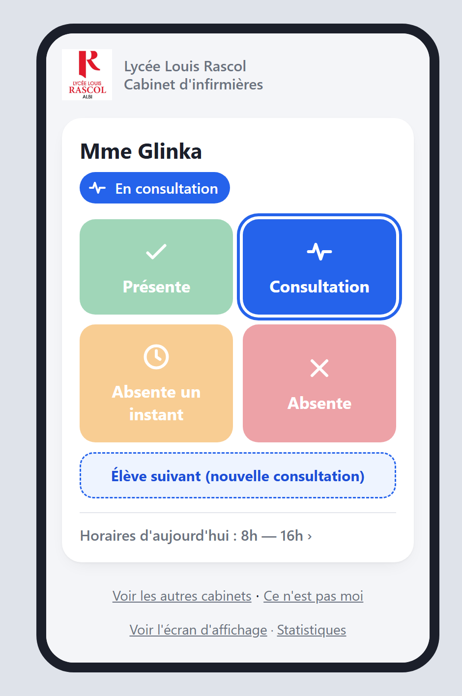
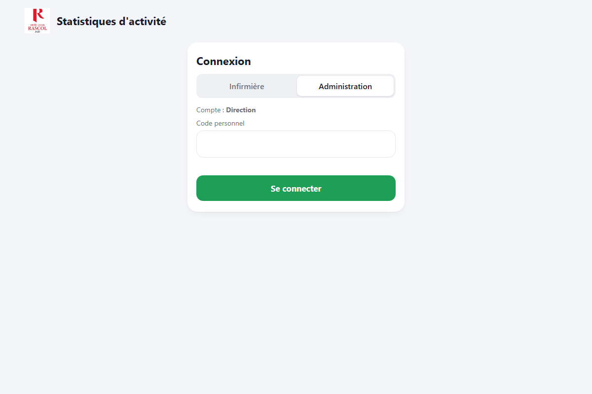
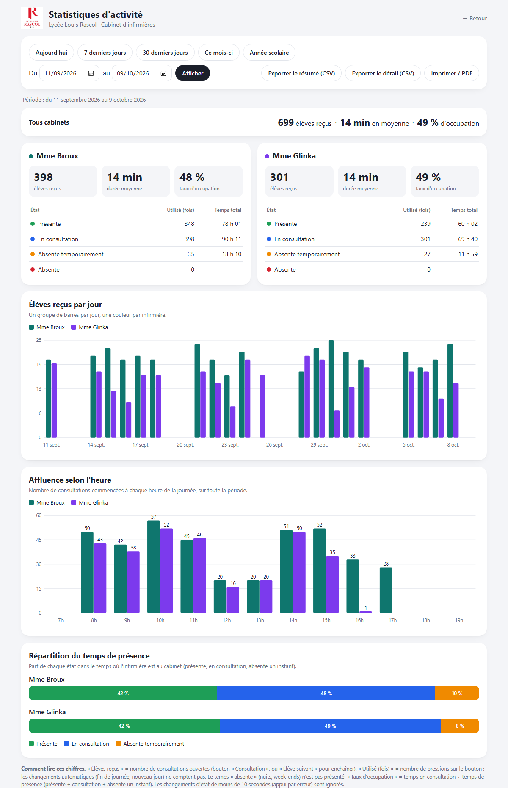
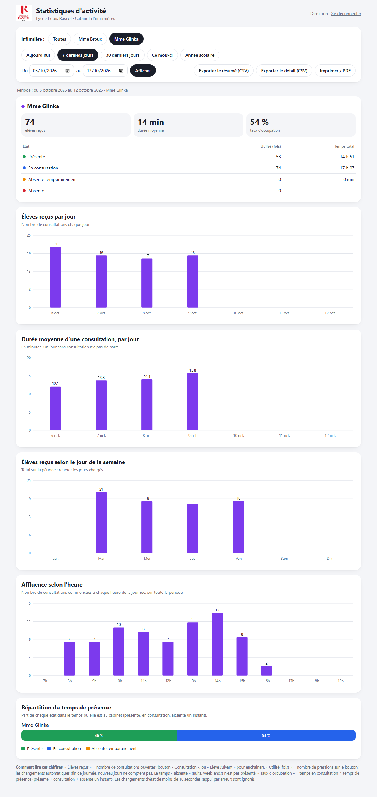
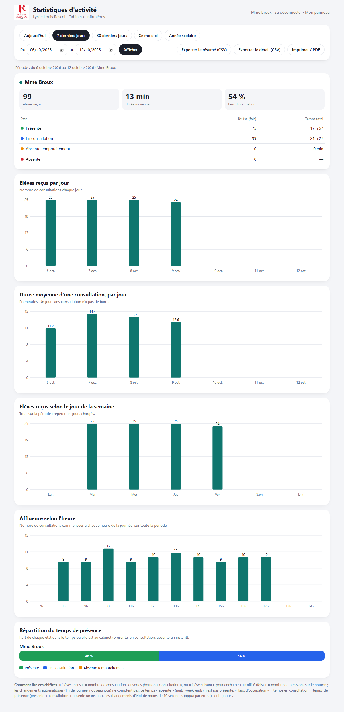

# Guide pas à pas : de la carte SD à l'écran en service

Ce guide refait toute la mise en place, dans l'ordre, avec le détail de chaque
geste. Chaque étape se termine par une **✅ Vérification** : ne passez à la
suivante que si elle est bonne.

**Convention** : les blocs `powershell` se tapent sur le **PC Windows** ; les blocs
`bash` se tapent sur le **Raspberry Pi**, une fois connecté en SSH (étape 5).
Les valeurs entre chevrons (`<IP>`, `<utilisateur>`) sont à remplacer par les vôtres.
Dans notre installation : IP `10.5.35.101`, nom d'hôte `pi-infirmerie`.

## Sommaire

0. [Le résultat visé](#0-le-résultat-visé)
1. [Matériel](#1-matériel)
2. [Préparer la carte SD](#2-préparer-la-carte-sd)
3. [Brancher et démarrer](#3-brancher-et-démarrer)
4. [Trouver l'adresse IP du Pi](#4-trouver-ladresse-ip-du-pi)
5. [Se connecter en SSH](#5-se-connecter-en-ssh)
6. [Installer l'application](#6-installer-lapplication)
7. [Vérifier le kiosque et redémarrer](#7-vérifier-le-kiosque-et-redémarrer)
8. [Réglages de l'écran et du réseau](#8-réglages-de-lécran-et-du-réseau)
9. [Utilisation par les infirmières](#9-utilisation-par-les-infirmières)
10. [Mettre à jour l'application](#10-mettre-à-jour-lapplication)
11. [Dépannage](#11-dépannage)
12. [Annexes](#12-annexes)

---

## 0. Le résultat visé

Le besoin de départ était ce schéma : une colonne par infirmière, un grand bloc
de couleur pour l'état, et les horaires du jour.


Le résultat obtenu, sur l'écran du couloir (ici, Mme Broux en consultation et
Mme Glinka absente temporairement, avec son retour prévu) :


Et avec une infirmière présente et l'autre absente :


| État | Couleur | Texte affiché |
|---|---|---|
| Présente | vert | PRÉSENTE |
| En consultation | bleu | EN CONSULTATION |
| Absente temporairement | orange | ABSENTE TEMPORAIREMENT, avec « Retour vers 14h30 » si renseigné |
| Absente (toute la journée) | rouge | ABSENTE |

Chaque infirmière change son état depuis son téléphone (voir [l'étape 9](#9-utilisation-par-les-infirmières)).

## 1. Matériel

| Élément | Remarque |
|---|---|
| Raspberry Pi | Testé sur un modèle 64 bits, 2 Go de RAM |
| Alimentation officielle | Une alimentation faible provoque des plantages |
| Carte microSD, 16 Go ou plus | De marque connue (SanDisk, Samsung…) |
| Lecteur de cartes SD pour le PC | Un lecteur USB externe est souvent plus fiable que celui d'un portable |
| Câble HDMI | Selon le modèle de Pi : HDMI ou micro-HDMI, vers l'écran |
| Câble réseau RJ-45 | Vers un port du switch ; le Wi-Fi n'est pas nécessaire |
| PC Windows | Avec [Raspberry Pi Imager](https://www.raspberrypi.com/software/) installé |

## 2. Préparer la carte SD

> ⚠️ La carte sera **entièrement effacée**. Sauvegardez ce qu'elle contient.

### 2.1 Lancer Pi Imager

1. Insérer la carte SD dans le lecteur du PC.
2. Ouvrir **Raspberry Pi Imager** (version 2.x dans notre cas). Les écrans se suivent dans le menu de gauche : *Appareil*, *Système*, *Stockage*, *Personnalisation*, *Écriture*, *Terminé*.

### 2.2 Choisir l'appareil, le système et le stockage

| Écran | Choix |
|---|---|
| **Appareil** | Votre modèle de Raspberry Pi |
| **Système** | **Raspberry Pi OS (64-bit)**, version **avec bureau** (la version « Lite » ne convient pas : il faut Chromium) |
| **Stockage** | La carte SD. **Vérifiez la taille** pour ne pas choisir un autre disque |

### 2.3 Personnalisation

Dans l'écran *Personnalisation*, renseigner :

| Réglage | Valeur |
|---|---|
| **Nom d'hôte** | `pi-infirmerie` (ou un autre nom sans espace) |
| **Localisation** | Fuseau horaire `Europe/Paris`, disposition du clavier `fr` |
| **Compte utilisateur** | Un identifiant (par exemple `infirmerie`) et un mot de passe solide. **Notez-les dans un gestionnaire de mots de passe.** Ne les écrivez jamais dans ce dépôt |
| **SSH** | **Activé**, authentification par mot de passe (ou par clé publique si vous en avez une) |
| Wi-Fi | Inutile : le Pi est branché en câble |

L'écran *Écriture* affiche ensuite un résumé : nom d'hôte, localisation et compte configurés, SSH activé. Vérifiez-le.

### 2.4 Écrire la carte

1. Cliquer sur **Écrire** et confirmer l'effacement.
2. Attendre la fin de l'écriture **et** de la vérification (quelques minutes).
3. Quand *Terminé* s'affiche, retirer la carte proprement.

✅ **Vérification** : Pi Imager indique que l'écriture et la vérification ont réussi.

### 2.5 Si l'écriture échoue

Message rencontré :



> *Error writing to storage device… Device disconnected or became unresponsive • Device is full or write-protected • Hardware failure or bad sectors*

La cause est presque toujours la carte, le lecteur ou l'état du disque, pas Pi Imager. Essayez **dans cet ordre** :

1. **Autre port USB** (en direct sur le PC, pas sur un hub) ou **autre lecteur** de cartes.
2. **Verrou physique** : sur l'adaptateur SD, le petit curseur doit être en position déverrouillée.
3. **Droits et antivirus** : lancer Pi Imager en administrateur (clic droit → *Exécuter en tant qu'administrateur*), et désactiver temporairement l'antivirus ou l'« Accès contrôlé aux dossiers » de Windows Defender.
4. **Nettoyer la carte avec `diskpart`** (invite de commandes **en administrateur**).
   > ⚠️ Vérifiez le numéro de disque **par sa taille**. Cette commande efface le disque choisi.
   ```
   diskpart
   list disk
   select disk X
   attributes disk clear readonly
   clean
   create partition primary
   format fs=fat32 quick
   exit
   ```
   Remplacer `X` par le numéro de la carte SD dans `list disk`.
5. **Reformater avec l'outil officiel** *SD Memory Card Formatter* (SD Association), option « Overwrite format ».
6. **Tester la carte** avec *H2testw* ou *F3* (fausse capacité ou carte défectueuse). Si possible, essayer **une autre carte** : si ça marche, la première est en fin de vie.
7. En dernier recours : une version précédente de Pi Imager (1.9.x) ou *balenaEtcher*.

## 3. Brancher et démarrer

1. Insérer la carte SD dans le Pi (fente sous la carte, contacts vers la carte).
2. Brancher **dans cet ordre** : le câble **HDMI** vers l'écran (écran allumé), le câble **réseau** vers le switch, puis l'**alimentation** en dernier.
3. Attendre **1 à 2 minutes**. Au premier démarrage, le Pi applique la personnalisation et peut redémarrer seul une fois.

✅ **Vérification** : le bureau de Raspberry Pi OS apparaît sur l'écran.

Si l'écran reste noir : vérifier que l'écran est sur la bonne entrée HDMI, que la LED verte du Pi clignote (accès à la carte), et que l'alimentation est suffisante.

## 4. Trouver l'adresse IP du Pi

Le PC doit être sur le même réseau que le Pi. Trois méthodes, de la plus simple à la plus technique.

### Méthode A : depuis le Pi

Sur le bureau du Pi, ouvrir un terminal (icône ▮ dans la barre du haut) et taper :
```bash
hostname -I
```
La première adresse affichée est l'IP (par exemple `10.5.35.101`).

### Méthode B : depuis le PC, avec le nom d'hôte

```powershell
ping pi-infirmerie.local
```
Si une réponse arrive, l'adresse IP est indiquée entre crochets. Si le nom n'est pas trouvé, passer à la méthode C.

### Méthode C : depuis le switch Aruba 2530

Se connecter à la console du switch (voir l'[annexe A](#a-console-du-switch-aruba-2530)), puis :
```
enable
show arp
show mac-address
```
`show arp` liste les adresses IP vues par le switch ; `show mac-address` indique **sur quel port** chaque machine est branchée. Repérer le port où le Pi est branché.

### Contrôle

```powershell
ping <IP>
```
Réponse attendue :
```
Réponse de 10.5.35.101 : octets=32 temps<1ms TTL=64
```
(`TTL=64` est typique d'un système Linux.)

✅ **Vérification** : le ping répond, sans perte de paquets.

## 5. Se connecter en SSH

### 5.1 Tester que SSH répond

```powershell
Test-NetConnection <IP> -Port 22
```
`TcpTestSucceeded : True` signifie que le service SSH écoute. Si c'est `False`, voir le [dépannage](#11-dépannage).

### 5.2 Se connecter

```powershell
ssh <utilisateur>@<IP>
```
- Au **premier** accès, une question sur l'empreinte du serveur apparaît : répondre `yes`.
- Saisir le mot de passe. **Rien ne s'affiche pendant la frappe** : c'est normal.

✅ **Vérification** : l'invite du Pi apparaît, du type `infirmerie@pi-infirmerie:~ $`.

### 5.3 Confort : connexion par clé (facultatif)

Évite de retaper le mot de passe. Sur le PC :

1. Créer une clé dédiée à ce Pi :
   ```powershell
   ssh-keygen -t ed25519 -f $env:USERPROFILE\.ssh\id_ed25519_pi -N '""'
   ```
2. Installer la clé publique sur le Pi (le mot de passe est demandé cette seule fois) :
   ```powershell
   type $env:USERPROFILE\.ssh\id_ed25519_pi.pub | ssh <utilisateur>@<IP> "mkdir -p ~/.ssh && chmod 700 ~/.ssh && cat >> ~/.ssh/authorized_keys && chmod 600 ~/.ssh/authorized_keys"
   ```
3. Tester :
   ```powershell
   ssh -i $env:USERPROFILE\.ssh\id_ed25519_pi <utilisateur>@<IP> hostname
   ```
   Le nom d'hôte du Pi doit s'afficher sans mot de passe.

Pour retirer un accès, supprimer la ligne correspondante dans `~/.ssh/authorized_keys` sur le Pi.

## 6. Installer l'application

### 6.1 Copier les fichiers sur le Pi

Sur le PC, depuis le dossier qui contient `cabinet` (récupéré avec `git clone <URL_DU_DEPOT>`) :
```powershell
scp -r cabinet <utilisateur>@<IP>:/home/<utilisateur>/
```

### 6.2 Créer la configuration

Sur le Pi (en SSH) :
```bash
cd ~/cabinet
cp config.example.json config.json
nano config.json
```
Contenu type, à adapter :
```json
{
  "school": "Lycée Louis Rascol",
  "title": "Cabinet d'infirmières",
  "logo": "branding/logo.png",
  "port": 8080,
  "domain": "pi-infirmerie.local",
  "minEventSeconds": 10,
  "sessionHours": { "nurse": 12, "admin": 2 },
  "admins": [
    { "id": "administration", "name": "Administration" }
  ],
  "nurses": [
    { "id": "broux",  "name": "Mme Broux",  "hours": { "default": ["08:00", "18:00"] } },
    { "id": "glinka", "name": "Mme Glinka", "hours": { "default": ["08:00", "16:00"] } }
  ]
}
```
Les codes d'accès ne s'écrivent **pas** dans ce fichier : ils se définissent avec `deploy/pins.py` (étape 8.3).

| Champ | Rôle |
|---|---|
| `school` | Nom de l'établissement (en-tête de la page des infirmières et des statistiques) |
| `title` | Titre affiché **au centre de l'écran** du couloir, entre le logo et l'heure |
| `logo` | Chemin du logo, relatif au dossier de l'application (PNG, JPG ou SVG). Absent : logo par défaut |
| `minEventSeconds` | Les changements d'état plus courts que cela (appui par erreur) sont ignorés dans les statistiques |
| `port` | Port HTTP du serveur (8080 par défaut) : écran public et redirection vers HTTPS |
| `domain` | Nom de l'écran public (par défaut `<nom-du-pi>.local`, annoncé automatiquement). Le panneau et les statistiques ont leur propre site : `<nom>-admin.local` et `<nom>-stats.local` ; avec un vrai nom DNS (`infirmerie.lycee.fr`) : `admin.…` et `stats.…` |
| `hosts` | Facultatif : choisir d'autres noms, par exemple `{ "admin": "panneau.lycee.fr", "stats": "chiffres.lycee.fr" }` |
| `tls` | Ajouté automatiquement par `deploy/setup-https.sh` : port HTTPS (8443 par défaut) et fichiers du certificat |
| `sessionHours` | Durée de connexion sans activité, en heures, pour les infirmières (`nurse`, 12 par défaut) et l'administration (`admin`, 2 par défaut) |
| `admins[]` | Comptes **administration** (accès aux statistiques de toutes les infirmières, en lecture seule) : `id` et `name` |
| `nurses[].id` | Identifiant court, sans espace ni accent |
| `nurses[].name` | Nom affiché sur l'écran |
| `hours.default` | Horaires habituels `["début", "fin"]` |
| `hours.mon` … `hours.sun` | Horaires propres à un jour (`mon`, `tue`, `wed`, `thu`, `fri`, `sat`, `sun`) |

Pour enregistrer dans `nano` : `Ctrl+O` puis `Entrée` ; pour quitter : `Ctrl+X`.

Exemple : horaires réduits le mercredi → `"hours": { "default": ["08:00","18:00"], "wed": ["08:00","12:00"] }`.

**Logo** : depuis le PC, copier le logo de l'établissement dans le dossier `branding` du Pi (le dossier `branding/` n'est pas versionné) :
```powershell
scp mon-logo.png <utilisateur>@<IP>:/home/<utilisateur>/cabinet/branding/logo.png
```
Pour un autre établissement, voir [ADAPTER.md](ADAPTER.md).

### 6.3 Vérifier Python

```bash
python3 --version
```
Une version 3.x s'affiche (Python 3.13 sur Raspberry Pi OS « trixie »). Aucune bibliothèque n'est à installer.

### 6.4 Lancer l'installation

```bash
sh deploy/install.sh
```
Sortie attendue :
```
Created symlink '.../default.target.wants/cabinet.service' → '.../cabinet.service'.
Installation terminée. Redémarrez le Pi : sudo reboot
```
Le script crée, **sans `sudo`** :
- `~/.config/systemd/user/cabinet.service` : le serveur, démarré automatiquement et relancé s'il plante ;
- `~/.config/labwc/autostart` : lance `deploy/kiosk.sh`, c'est-à-dire Chromium en plein écran sur `http://localhost:8080/` (relancé s'il se ferme).

> `autostart` remplace celui du système : plus de barre des tâches ni de bureau à l'écran. C'est voulu pour un kiosque. Pour revenir au bureau : supprimer `~/.config/labwc/autostart`.

### 6.5 Contrôler le serveur

```bash
systemctl --user status cabinet.service
curl localhost:8080/api/state
```
La première commande doit afficher `active (running)`. La seconde renvoie du JSON où figurent vos infirmières, toutes en `"status": "absent"` au départ.

✅ **Vérification** : service actif et JSON reçu.

## 7. Vérifier le kiosque et redémarrer

1. Redémarrer :
   ```bash
   sudo reboot
   ```
2. Attendre environ une minute. Sans toucher à rien, l'écran doit afficher le logo, l'heure et une carte rouge « ABSENTE » par infirmière :

   
   *(Capture avec une infirmière présente ; au tout premier démarrage, les deux cartes sont rouges.)*

✅ **Vérification** : l'affichage apparaît tout seul, en plein écran, sans curseur ni barre.

Si ce n'est pas le cas :
```bash
systemctl --user status cabinet.service     # le serveur tourne-t-il ?
cat ~/.config/labwc/autostart               # le kiosque est-il déclaré ?
~/cabinet/deploy/kiosk.sh                   # le lancer à la main depuis le bureau
```

## 8. Réglages de l'écran et du réseau

### 8.1 Empêcher l'extinction de l'écran

```bash
sudo raspi-config
```
Menu *Display Options* → *Screen Blanking* → **désactiver**. Valider puis quitter.

### 8.2 Fixer l'adresse IP

Si l'IP change, les téléphones ne retrouvent plus la page. Demander au service informatique une **réservation DHCP** liée à l'adresse MAC du Pi :
```bash
ip link show eth0
```
La ligne `link/ether xx:xx:xx:xx:xx:xx` donne l'adresse MAC.

### 8.3 Sécuriser les accès : codes personnels et HTTPS (obligatoire)

Le Pi est joignable par tout le réseau du lycée, **élèves compris**. Sans protection, n'importe qui pourrait modifier l'affichage. Les accès sont donc protégés ainsi :

- chaque **infirmière** a son **code personnel** : elle pilote **son** panneau et voit **ses** statistiques ;
- l'**administration** a son propre code : elle voit les statistiques de **toutes**, en lecture seule ;
- l'écran du couloir reste public (il ne montre que la présence) ;
- les codes ne circulent qu'en **HTTPS** (chiffré).

**Tant qu'aucun code n'est défini, personne ne peut se connecter** : c'est voulu, rien n'est ouvert par défaut.

**À faire une seule fois**, sur le Pi, en SSH :

1. Activer le chiffrement :
   ```bash
   cd ~/cabinet
   sh deploy/setup-https.sh
   ```
2. Générer les codes (affichés **une seule fois**, notez-les) :
   ```bash
   python3 deploy/pins.py generate
   ```
   Pour choisir vous-même un code : `python3 deploy/pins.py set nurse:broux`. Remettez chaque code à son titulaire **en main propre**, puis effacez le terminal (`clear`).
3. Redémarrer le serveur :
   ```bash
   systemctl --user restart cabinet.service
   ```
4. Installer l'**autorité de certification** `certs/ca.crt` sur les appareils (PC de l'administration, téléphones des infirmières), une seule fois par appareil, pour supprimer l'avertissement de sécurité du navigateur (marche à suivre dans [SECURITE.md](SECURITE.md)).

✅ **Vérification** : `https://pi-infirmerie-admin.local:8443/` affiche l'écran de connexion, sans avertissement du navigateur.

Tout le détail (blocage après des essais ratés, durée des sessions, journal des connexions, code oublié, pare-feu, renouvellement du certificat) est dans **[SECURITE.md](SECURITE.md)**.

### 8.4 Accès à distance au bureau du Pi (VNC)

Le VNC permet de **voir et piloter l'écran du Pi depuis un autre PC** du réseau, sans se déplacer devant l'écran du couloir : utile pour dépanner, vérifier l'affichage ou ouvrir un navigateur sur le Pi. Il utilise `wayvnc`, le serveur VNC fourni avec Raspberry Pi OS pour le bureau actuel (Wayland).

**Installation** (sur le Pi, en SSH, sans `sudo`) :
```bash
sh ~/cabinet/deploy/setup-vnc.sh
```
Le script :
- crée un **certificat TLS** (connexion chiffrée) et une clé RSA dans `~/.config/wayvnc/` ;
- génère un **mot de passe aléatoire** pour l'utilisateur `vnc`, stocké dans `~/.config/wayvnc/config` (lisible uniquement par votre compte) ;
- installe et active le service utilisateur `wayvnc.service`, démarré avec le bureau et relancé s'il s'arrête.

Il peut être relancé sans risque : le mot de passe et le certificat existants ne sont jamais écrasés.

**Récupérer le mot de passe** (sur le Pi, en SSH) :
```bash
grep '^password=' ~/.config/wayvnc/config
```

**Se connecter depuis l'autre PC**
1. Installer un client VNC gratuit : [RealVNC Viewer](https://www.realvnc.com/fr/connect/download/viewer/) ou [TigerVNC](https://tigervnc.org/) (les deux sont compatibles).
2. Se connecter à l'adresse du Pi **sans préciser de port** : `10.5.35.101` (le port 5900 est le port par défaut). Si vous devez absolument le préciser, écrivez-le avec **deux** deux-points : `10.5.35.101::5900`. Avec un seul (`10.5.35.101:5900`), TigerVNC l'interprète comme un numéro d'écran et tente le port 59000, qui échoue avec « connexion refusée ».
3. Accepter l'avertissement sur le certificat à la première connexion : c'est normal, le certificat est auto-signé et propre à ce Pi.
4. Saisir l'utilisateur `vnc` et le mot de passe.

Vous voyez alors l'écran du couloir en direct, avec la souris et le clavier.

✅ **Vérification** : le bureau (ici, la page d'affichage plein écran) apparaît dans le client VNC.

**À savoir**
- **Contrôle** : toute personne connectée pilote le Pi. En mode kiosque, fermer Chromium le relance tout seul après 2 secondes.
- **Sécurité** : le port 5900 est ouvert à tout le réseau du lycée. La connexion est chiffrée et protégée par mot de passe, mais ne l'exposez **jamais sur Internet** (pas de redirection de port). Pour restreindre l'accès à certains PC, demandez au service informatique de filtrer le port 5900.
- **Changer le mot de passe** : éditer la ligne `password=` de `~/.config/wayvnc/config`, puis `systemctl --user restart wayvnc.service`.
- **Désactiver le VNC** : `systemctl --user disable --now wayvnc.service`.
- **Dépannage** : `systemctl --user status wayvnc.service` (état), `journalctl --user -u wayvnc.service -n 20` (journaux). Le service a besoin que le bureau soit ouvert : il redémarre seul tant que ce n'est pas le cas.
- **Autre solution** : l'outil officiel RealVNC (`vncserver-x11-serviced`) est aussi installé mais désactivé ; son activation demande `sudo` (`sudo raspi-config` → *Interface Options* → *VNC*).

## 9. Utilisation par les infirmières

### 9.1 Ouvrir la page (sans taper l'adresse IP)

Sur le téléphone (connecté au réseau du lycée), ouvrir :

```
https://pi-infirmerie-admin.local:8443/
```
Le panneau des infirmières a **son propre site** (`pi-infirmerie-admin.local`), distinct des statistiques (`pi-infirmerie-stats.local`) et de l'écran public (`pi-infirmerie.local`). Ces noms remplacent l'adresse IP et suivent le Pi même si son IP change. Les anciens liens `…/admin` et `…/stats` redirigent vers le bon site. Avec les **ports standards** (`sh deploy/use-standard-ports.sh`, voir [SECURITE.md](SECURITE.md)), l'adresse devient simplement `https://pi-infirmerie.local`.

Chaque infirmière enregistre la page en **favori** ou l'ajoute à l'**écran d'accueil** du téléphone, ou scanne un **QR code** collé près de l'écran : un seul geste ensuite. Cette adresse ouvre l'écran de connexion, jamais un panneau.

> Un lien personnel présélectionne le nom : `https://pi-infirmerie-admin.local:8443/?me=broux`. Le code reste obligatoire.

### 9.2 Se connecter avec son code personnel

1. Toucher **son nom** (il est présélectionné si le lien contient `?me=`).
2. Saisir **son code personnel** (le champ est masqué) et toucher **Se connecter**.



Si le code est faux, un message l'indique :



- Après **5 codes faux** de suite, la connexion est bloquée quelques minutes (voir [SECURITE.md](SECURITE.md)).
- L'infirmière reste connectée **12 heures** sans activité ; au-delà, il suffit de se reconnecter.
- **Sur un téléphone ou un PC partagé, toujours toucher « Se déconnecter »** (lien en bas de la page).
- **Code oublié** : le demander à la personne qui administre le Pi, qui en définit un nouveau (`python3 deploy/pins.py set nurse:<id>`).

Une infirmière ne voit **que son propre panneau** : elle ne peut pas modifier celui d'une collègue.

### 9.3 Changer d'état

La page montre l'état actuel (bandeau en haut) et quatre gros boutons. Le bouton actif est entouré, les autres sont atténués.



| Bouton | Quand l'utiliser |
|---|---|
| **Présente** (vert) | Je suis au cabinet |
| **Consultation** (bleu) | Je reçois un élève |
| **Absente un instant** (orange) | Je m'absente un moment |
| **Absente** (rouge) | Je ne suis pas là |

Un message « Écran mis à jour ✓ » confirme le changement, et l'écran du couloir change en moins d'une seconde.

### 9.4 Indiquer un retour (absence temporaire)

Après avoir touché **Absente un instant**, une zone « Retour prévu (facultatif) » apparaît :


- **15 min**, **30 min**, **1 h** : propose une heure de retour arrondie aux 5 minutes ;
- le champ d'heure permet de saisir une heure précise ;
- **Effacer** retire l'heure de retour.

L'écran affiche alors « Retour vers 14h30 ». Si l'heure est dépassée sans changement d'état, il affiche « Retour imminent ».

### 9.5 Modifier les horaires du jour

Toucher « Horaires d'aujourd'hui », régler l'heure de début et de fin, puis **Enregistrer**. La mention « (modifiés) » apparaît, et **Rétablir les horaires habituels** annule la modification.



Ces horaires ne valent que pour la journée en cours.

### 9.6 Comportements automatiques

- **À l'heure de fin** des horaires du jour, l'infirmière repasse toute seule en **Absente**. Cela ne se produit qu'une fois : si elle se remet « Présente » après son heure de fin (elle reste plus tard), son choix est respecté. Si elle allonge ses horaires, la fermeture est réarmée pour la nouvelle heure de fin.
- **Chaque nuit** (changement de date), tout le monde repasse en **Absente** avec les horaires habituels. Il n'y a donc pas de « Présente » oublié le lendemain.
- **Avant l'heure de début**, rien n'est forcé : une infirmière arrivée plus tôt peut se mettre « Présente » dès son arrivée.

### 9.7 Remplacement d'une collègue

Chaque panneau n'est modifiable que par sa propriétaire. Pour qu'une personne en remplace une autre, la propriétaire du compte lui **communique son code pour la durée du remplacement**, puis **demande un nouveau code** (`python3 deploy/pins.py set nurse:<id>`), ce qui ferme les sessions ouvertes. Un code est personnel : ne le laissez pas à disposition.

### 9.8 Enchaîner les élèves : « Élève suivant »

Pendant une consultation, un bouton **Élève suivant (nouvelle consultation)** apparaît :



- Quand un élève sort et qu'un autre entre directement, toucher **Élève suivant** : l'écran reste en « En consultation », mais une **nouvelle consultation** est comptée dans les statistiques.
- Si le cabinet se vide entre deux élèves, repasser en **Présente**, puis **Consultation** au suivant.
- Toucher plusieurs fois **Consultation** pendant la même consultation ne compte qu'**un seul** élève.

Ce geste alimente directement le nombre d'élèves reçus et la durée moyenne des consultations (section suivante).

✅ **Vérification** : changer un état depuis un téléphone ; l'écran change en moins d'une seconde.

### 9.9 Consulter les statistiques d'activité

Chaque changement d'état est enregistré dans un journal (base SQLite `data.db` sur le Pi, sans rien à installer). La page de statistiques le restitue, **après connexion** :

```
https://pi-infirmerie-stats.local:8443/
```

**Qui voit quoi**

| Compte | Statistiques visibles |
|---|---|
| **Administration** | Celles de **toutes** les infirmières, avec le sélecteur « Toutes / une infirmière » (lecture seule) |
| **Infirmière** | **Uniquement les siennes** (pas de sélecteur) ; en essayant `?nurse=<autre>`, elle ne voit toujours que les siennes |
| Sans compte | Rien : un écran de connexion |

Les exports CSV suivent les mêmes règles. La page des infirmières propose le lien **« Mes statistiques »** en bas.

**Se connecter** : onglet **Administration** (code du compte administration) ou onglet **Infirmière** (son nom et son code).



Les données des captures ci-dessous sont **fictives** (démonstration sur 4 semaines). Vue de l'**administration** :



**Choisir l'infirmière** (administration) : la ligne « Infirmière » en haut permet de voir **toutes les infirmières** côte à côte, ou **une seule** (*Mme Broux*, *Mme Glinka*…). Le choix s'applique aux chiffres, aux graphiques et aux exports CSV.

Vue de l'administration filtrée sur **une infirmière** :



Vue d'une **infirmière connectée** (elle ne voit que ses chiffres, sans sélecteur) :



> Les droits sont vérifiés **par le serveur** à chaque requête : une infirmière ne peut pas voir les chiffres d'une collègue en modifiant l'adresse. Le compte administration est en **lecture seule** : il ne peut piloter aucun panneau.

**Choisir la période** : *Aujourd'hui*, *7 derniers jours*, *30 derniers jours*, *Ce mois-ci*, *Année scolaire*, ou deux dates au choix puis **Afficher**.

**Ce que la page indique, pour chaque infirmière et pour l'ensemble des cabinets**

| Indicateur | Définition |
|---|---|
| **Élèves reçus** | Nombre de consultations ouvertes (bouton *Consultation* ou *Élève suivant*) |
| **Durée moyenne** | Durée moyenne d'une consultation |
| **Taux d'occupation** | Temps en consultation ÷ temps de présence au cabinet (présente + consultation + absente un instant) |
| **Utilisé (fois)** | Nombre de pressions sur chaque état. Les changements **automatiques** (fin de journée, nouveau jour) ne comptent pas |
| **Temps total** | Temps passé dans chaque état (sauf « Absente », dont le temps inclut nuits et week-ends) |

**Les graphiques**
- *Élèves reçus par jour* : une barre par infirmière et par jour ;
- *Durée moyenne d'une consultation, par jour* : en minutes, pour voir si les consultations s'allongent ;
- *Élèves reçus selon le jour de la semaine* : total par lundi, mardi, etc., pour repérer les jours chargés ;
- *Affluence selon l'heure* : à quelles heures les consultations commencent (repérer les heures de pointe) ;
- *Répartition du temps de présence* : part de la présence, de la consultation et des absences brèves.

**Restituer et partager les chiffres**

| Besoin | Moyen |
|---|---|
| Ouvrir dans Excel / LibreOffice | **Exporter le résumé (CSV)** : une ligne par infirmière (ou une seule si une infirmière est sélectionnée) |
| Analyse détaillée | **Exporter le détail (CSV)** : chaque changement d'état, avec début, fin, durée et origine (manuelle ou automatique) ; limité à l'infirmière sélectionnée, le nom du fichier l'indique |
| Rapport pour la direction | **Imprimer / PDF** : la mise en page est prévue pour l'impression ; choisir « Enregistrer au format PDF » |

Les fichiers CSV utilisent le point-virgule et la virgule décimale : ils s'ouvrent directement dans Excel français.

**Précisions utiles**
- Les mesures commencent au déploiement de cette version : il n'y a pas d'historique avant.
- Les changements d'état de moins de `minEventSeconds` secondes (10 par défaut), c'est-à-dire un appui par erreur aussitôt corrigé, sont ignorés.
- Si le Pi est éteint plus de 2 minutes, le journal arrête les mesures à la dernière heure connue (une panne ne gonfle pas les durées).
- Les statistiques ne s'ouvrent qu'après connexion (étape 8.3) ; l'administration voit tout, chaque infirmière voit les siennes.
- Les données restent sur le Pi (`data.db`). Pour une sauvegarde, copier ce fichier.

## 10. Mettre à jour l'application

Depuis le PC, après modification du code :
```powershell
scp -r cabinet\server.py cabinet\static <utilisateur>@<IP>:/home/<utilisateur>/cabinet/
ssh <utilisateur>@<IP> "systemctl --user restart cabinet.service"
```
Pour une modification de la page d'affichage seulement, copier le fichier puis recharger l'écran (redémarrer le Pi, ou fermer Chromium : `kiosk.sh` le relance).

Modifier la configuration (noms, horaires) : éditer `~/cabinet/config.json` sur le Pi, puis `systemctl --user restart cabinet.service`.

Les fichiers `config.json` et `state.json` ne sont jamais écrasés par une mise à jour si vous ne copiez que `server.py` et `static`.

## 11. Dépannage

### Réseau et connexion

| Symptôme | Cause probable | Solution |
|---|---|---|
| `ping` ne répond pas | Mauvaise IP, Pi éteint, PC sur un autre réseau | Revoir l'étape 4 ; vérifier le câble réseau et le VLAN du port du switch |
| SSH : `Connection timed out` | Pi non démarré ou injoignable | Vérifier l'alimentation, le câble, l'IP |
| SSH : `Connection refused` | SSH non activé | Refaire la personnalisation de la carte (étape 2.3) |
| SSH : `Permission denied` | Mauvais identifiant ou mot de passe | Vérifier la casse et le clavier (AZERTY/QWERTY) |
| `/admin` injoignable depuis le téléphone | Téléphone en 4G ou sur un autre réseau | Se connecter au réseau du lycée ; vérifier qu'il peut joindre l'IP du Pi |

### Application

| Symptôme | Cause probable | Solution |
|---|---|---|
| Écran noir au démarrage | Serveur ou kiosque non lancé | Voir l'étape 7 |
| Écran qui s'éteint | Veille activée | Étape 8.1 |
| Petite pastille orange en bas à droite de l'écran | Connexion au serveur perdue | Elle disparaît toute seule et la page se recharge au retour du serveur ; sinon, redémarrer le service |
| Les changements n'apparaissent pas | Page ancienne ou serveur bloqué | Recharger la page ; `curl localhost:8080/api/state` sur le Pi |
| « Ce compte n'est pas activé » | Aucun code défini pour ce compte | `python3 deploy/pins.py set <compte>` (voir [SECURITE.md](SECURITE.md)) |
| « Trop de tentatives, réessayez dans X min » | Plusieurs codes faux : blocage temporaire | Attendre ; ou redémarrer le service pour débloquer |
| Avertissement de sécurité du navigateur sur `https://…` | L'autorité `ca.crt` n'est pas installée sur cet appareil | Installer `certs/ca.crt` (SECURITE.md, section 2) |
| Redirigé vers `https://…:8443` qui ne répond pas | Le port 8443 est filtré par le réseau | Demander au service informatique d'autoriser le port 8443 (ou passer en 443) |
| Statistiques vides | Aucune activité sur la période (les mesures commencent à l'installation) | Choisir une autre période ; vérifier que `data.db` existe dans `~/cabinet` |
| Chiffres étonnants (élèves en trop ou en moins) | Appuis par erreur ou consultation oubliée ouverte | Utiliser « Élève suivant » uniquement pour enchaîner ; le détail CSV montre chaque événement |
| Message « Serveur injoignable » sur le téléphone | Réseau coupé | Vérifier la connexion du téléphone |

### Commandes utiles sur le Pi

```bash
systemctl --user status cabinet.service     # état du serveur
journalctl --user -u cabinet.service -f     # journaux en direct (Ctrl+C pour quitter)
systemctl --user restart cabinet.service    # redémarrer le serveur
curl localhost:8080/api/state               # état courant (JSON)
```
Remettre l'état à zéro :
```bash
systemctl --user stop cabinet.service
rm ~/cabinet/state.json
systemctl --user start cabinet.service
```

## 12. Annexes

### A. Console du switch Aruba 2530

Utile pour trouver l'IP du Pi ou régler le réseau.

1. Brancher un câble micro-USB **de données** (pas un simple câble de charge) sur le port console à l'avant du switch.
2. Dans le Gestionnaire de périphériques, repérer le port `COMx` sous *Ports (COM et LPT)*. S'il manque, installer le pilote **Silicon Labs CP210x** puis rebrancher.
3. Ouvrir **PuTTY** ou **Tera Term** avec : connexion *Serial*, port `COMx`, **9600** bauds, 8 bits de données, aucune parité, 1 bit d'arrêt, **aucun** contrôle de flux. Appuyer plusieurs fois sur `Entrée`.
4. Commandes utiles :
   ```
   enable
   show ip                   # adresses IP du switch et des VLAN
   show arp                  # machines vues sur le réseau
   show mac-address          # port auquel chaque machine est branchée
   configure
   vlan 1
   ip address 192.168.1.10 255.255.255.0
   exit
   telnet-server             # activer Telnet (préférer SSH si possible)
   password manager          # définir un mot de passe
   write memory              # enregistrer la configuration
   ```
5. Se connecter ensuite au switch en Telnet depuis le PC (fonction à activer dans Windows) :
   ```powershell
   dism /online /Enable-Feature /FeatureName:TelnetClient
   telnet 192.168.1.10
   ```
6. Mot de passe perdu : le bouton **Clear** en façade l'efface. Le bouton **Reset** redémarre le switch ; une réinitialisation d'usine efface toute la configuration.

> Telnet transmet les mots de passe en clair. Préférer SSH quand c'est possible.

### B. Architecture

```
Téléphone / PC infirmière ──► /admin ──POST /api/set──┐
                                                       ▼
                                     server.py (Python, état dans state.json)
                                                       │ Server-Sent Events (/api/events)
                                                       ▼
        Chromium kiosque sur le Pi (HDMI) ◄── /  (page d'affichage)
```

| Fichier | Rôle |
|---|---|
| `server.py` | Serveur HTTP, temps réel (SSE), validation, sauvegarde de l'état, fermeture automatique |
| `config.json` | Infirmières, administration, horaires, codes hachés (non versionné, droits 600) |
| `auth.py` | Comptes, codes hachés, sessions, limitation des essais |
| `certs/` | Autorité locale et certificat HTTPS (secrets, non versionnés) |
| `auth.log` | Journal des connexions (non versionné) |
| `deploy/pins.py` | Définir / changer les codes des comptes |
| `deploy/setup-https.sh` | Activer le HTTPS (autorité locale + certificat) |
| `deploy/use-standard-ports.sh` | Ports 80/443 (demande `sudo`) |
| `static/index.html` | Page d'affichage de l'écran |
| `static/admin.html` | Page de commande des infirmières |
| `static/stats.html` | Tableau de bord des statistiques |
| `branding/` | Logo de l'établissement (non versionné) |
| `data.db` | Journal des changements d'état, base SQLite (non versionnée) |
| `static/common.js` | Statuts, couleurs et fonctions partagées |
| `deploy/install.sh` | Installation du service et du kiosque |
| `deploy/setup-vnc.sh` | Accès à distance au bureau du Pi (VNC, chiffré, avec mot de passe) |

Pour les captures d'écran de cette documentation, l'option `?nosse` (par exemple `/?nosse`) désactive le flux temps réel.

### C. Publier le dépôt sur GitHub

```bash
gh auth login
cd cabinet
gh repo create affichage-infirmerie --private --source=. --push
```
`config.json` (noms du personnel) et `state.json` sont exclus par `.gitignore` et ne sont jamais publiés. **Ne jamais commiter** de mot de passe, de code d'accès ni de clé privée.

### D. Sécurité en bref

- L'application est prévue pour le **réseau interne** du lycée : ne pas l'exposer sur Internet.
- Chaque infirmière a **son code personnel**, l'administration a le sien ; ils circulent uniquement en **HTTPS** (étape 8.3 et [SECURITE.md](SECURITE.md)).
- Se déconnecter sur un appareil partagé ; remplacer un code dès qu'il est connu d'un tiers (`python3 deploy/pins.py set <compte>`).
- Limiter les ports SSH (22) et VNC (5900) du Pi aux postes de l'informatique ([SECURITE.md](SECURITE.md), section 7).
- Garder les identifiants du Pi hors du dépôt et hors des messages partagés.
- Utiliser une clé SSH dédiée, révocable, plutôt que de partager le mot de passe du Pi.
